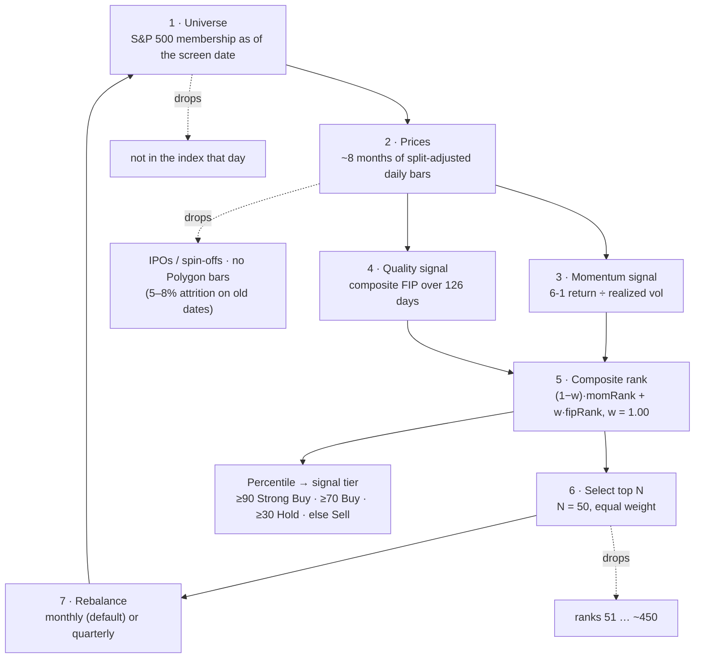

# How Quantitative Momentum works

The canonical explanation of the QM method **as implemented in this skill**. Read this before
explaining the strategy, drawing a flowchart, or answering "how does QM work / what is FIP /
why skip a month". Every number here is traceable to `scripts/qm_screener.py` or
`scripts/qm_backtest.py` — if code and doc disagree, the code is right and this file is stale
(see *Keeping this current* at the bottom).

**Last verified against the code:** 2026-08-04.

---

## The one-sentence version

Ordinary momentum asks *how much* a stock went up. Quantitative Momentum asks *how it got
there*, and ranks the steady grinders above the gap-and-drift names that posted the same return
in one jump.

That is Gray & Vogel's **frog-in-the-pan** hypothesis: information that arrives in small
continuous increments gets under-reacted to, so smooth momentum persists while jumpy momentum
has already spent itself.

```
     high FIP — steady grind              low FIP — one gap, then noise
                          ●                                        ●
                      ╱                          ╱╲      ╱╲    ╱
                  ╱                          ╱      ╲╱      ╲╱
              ╱                            ╱
          ╱                          ────╯
     ────                            ────
     same 6-month return · ranks top     same 6-month return · ranks low
```

---

## The pipeline



---

## Stage by stage

### 1 · Universe — point-in-time, never today's list

Live runs take the S&P 500 from Wikipedia. `--as-of` runs take membership from the fja05680
historical panel in `C:\Users\ssair\s&p Historic Data\` — the most recent snapshot on or before
the as-of date. The **backtester's `--universe pit` path** takes it from Postgres instead:
`ref.index_membership` in the `trading` DB on localhost:5433, stored as ~1,270 half-open
intervals that get swept into one snapshot per change date.

Using today's constituents to screen a past date silently guarantees you only pick companies
that survived. That is the single most common way a momentum backtest inflates itself, and it
is why the as-of path refuses to fall back to Yahoo (survivor-only, dividend-adjusted).

### 2 · Prices — ~8 months of daily bars

Enough history for a 6-1 momentum window (7 months) plus the 126-day FIP lookback. Polygon
grouped daily bars are primary; they are splits-adjusted and point-in-time. One split vintage
throughout — mixing adjusted and unadjusted bars manufactures fake momentum on exactly the
names that split, which are the winners.

The **backtester's `--universe pit` path reads prices from Postgres**, not from Polygon:
`mkt.price_daily`, restricted to every security that was ever an index member, pulled from two
years before the backtest start. That panel includes delisted names, which is the whole reason
to source it there — per-rebalance price coverage of point-in-time members is now **100.0% avg,
99.8% min**, against the ~70% of the free survivor-reduced panel it replaced (Aug-2026).

Two properties of that panel to carry into any claim made from it: it is keyed by
**`security_id`, never by ticker** — 213 tickers denote more than one company across time, and
joining through the string once produced a +4925% month that looked like alpha — and it is
**split-adjusted only, not dividend-adjusted**, so these are price returns.

That second property sets the benchmark. On the PIT path SPY comes from the *same* table, so
both sides are price return and `benchmark_basis` in the results JSON says `price_return`; the
Yahoo fallback on the wikipedia path is total return on both sides and says `total_return`.
**Never compare an `excess_return` across the two** — benchmarking this panel against a
total-return SPY charges the strategy ~2.1pp/yr of SPY yield it never had the chance to earn.
That single mismatch is the difference between −1.6pp and +0.5pp on the 2015–26 run.

### 3 · Momentum — 6-1, volatility-adjusted

Prices are resampled to month-ends, then:

```
mom_6_1     = monthly[-2] / monthly[-8] − 1          (×100, in %)
realized_vol = std(last 126 daily returns) × √252 × 100 , floored at 5.0
volAdjMom    = mom_6_1 / realized_vol
```

Two deliberate choices:

- **The skipped month.** One-month returns mean-revert. Including the most recent month buys
  the short-term losers and sells the short-term winners — the classic momentum-strategy own
  goal.
- **The vol divide.** A calm 20% and a violent 20% are not the same signal. Added by
  autoresearch (Mar-2026 hybrid run): Sharpe 1.09 → 1.70, max DD −37.5% → −33.6%.

`3M Ret%` and `1M Ret%` are also computed, with **no skip**, purely as context columns. They
do not enter the ranking.

*Code:* `qm_screener.py::calculate_momentum`

### 4 · Quality — the composite FIP score

Two questions about the *path* over the last **126 trading days (~6 months)**, equally weighted:

```
pctPositive  = #(daily return > 0) / #days
pathR2       = R² of cumulative return regressed on time      (0 if the fit fails)
FIP          = 0.5 · pctPositive + 0.5 · pathR2
```

Both components are naturally on a 0–1 scale, so they are combined **raw — no z-scoring**.
Higher FIP = more consistent, more linear ascent. This is where gap-driven and event-driven
winners sink.

*Code:* `qm_screener.py::calculate_fip_score`

### 5 · Composite rank

Momentum and FIP are each converted to a **rank** (1 = best), then blended:

```
composite = (1 − fip_weight) · momRank + fip_weight · fipRank      fip_weight = 1.00
```

At **w = 1.00 the ranking is pure quality** — the composite rank *is* the FIP rank, and
volatility-adjusted momentum is demoted to a context column. That is not a shortcut; it won
the survivorship-reduced 20.5-year sweep (Jun-2026), and FIP weight was monotonically positive
on the composite metric across every sample tested. Gray's book weight is 0.5; the prior
default here was 0.75.

The honest reading of that result: **FIP is a risk/drawdown filter, not a return predictor.**
On unbiased data the FIP quality premium was ~neutral (1 of 20 experiments positive). What
w = 1.0 bought was Sharpe 1.28 and max DD −41.6%, against 0.91 / −48.6% at w = 0.5.

Percentile then maps to a signal tier: **≥90 Strong Buy · ≥70 Buy · ≥30 Hold · else Sell.**

*Code:* `qm_screener.py::build_qm_ranking`

### 6 · Select the top N, equal weight

Default `--n-holdings 50` — roughly the top decile of the index. Equal weighting is the point:
cap weighting hands the portfolio straight back to the mega-caps already owned via SPY, and the
whole premise is a tilt away from that.

### 7 · Rebalance, then start over

Backtester default is **monthly** (`--rebalance quarterly` for Gray's original). Monthly was
the biggest single-parameter lever in the Mar-2026 autoresearch: +0.46 composite points. The
tradeoff is real and lands outside the backtest — higher turnover, more spread paid, more
short-term gains realized.

---

## What it's actually worth

State this whenever the strategy is explained. The book's numbers are not this investor's
numbers.

| Measure | Value | Source |
|---|---|---|
| Honest QM vs SPY, 2004–26 | **+1.2 %/yr** | PIT backtest after the look-ahead + survivorship fixes |
| Sharpe | **0.56** | same |
| Max drawdown | **−52 %** | same |
| Raw (ungated) QM vs SPY, full history | **−1.2 pp** | full-history verdict run |
| Gated QM vs SPY | **+1.4 pp** | conditional risk-on selection edge, minus timing drag |

Two failure modes already found and fixed here, worth naming so they are not re-introduced:

- A **1-month look-ahead** in the backtest engine, compounded by survivorship, inflated results
  ~3×. The June-2026 autoresearch figure of +11.5 %/yr excess was fiction. Always run
  `--universe pit`.
- The **QM persistence signal is regime-dependent**: +6 pp in 2022–26, −0.9 pp over the full
  2004–2026 window. Test full history before believing any QM result.

The autoresearch Sharpe figures quoted in stage 5 come from the in-sample parameter sweep and
are **not** comparable to the honest PIT backtest row above. Do not mix them in one sentence.

Bottom line to give the user: a faithful implementation of the book, and a weak conditional
tilt worth sizing small — not an index-beater.

---

## Keeping this current

**This document is part of the skill's contract.** Any change to the screener, backtester, or
defaults must land in the same edit as its update here. Specifically, update this file when:

| If you change… | Update |
|---|---|
| `fip_weight`, or the composite rank formula | Stage 5 + the mermaid node |
| FIP components or `lookback_days` | Stage 4 formula block |
| `lookback_months` / `skip_months` / vol adjustment | Stage 3 formula block |
| Signal-tier percentile cutoffs | Stage 5 + the mermaid node |
| `--n-holdings` or `--rebalance` defaults | Stages 6–7 + the mermaid node |
| Universe or price-source rules | Stages 1–2 |
| Any new backtest result that supersedes a row | The *What it's actually worth* table |

Then bump **Last verified against the code** at the top, and re-verify the formula blocks
against the actual functions rather than trusting the previous text.

A rendered version of this flowchart lives at
<https://claude.ai/code/artifact/566433a3-87ee-4dcd-a376-3a317f8016a5> — republish it from this
file's content when the pipeline changes materially.
